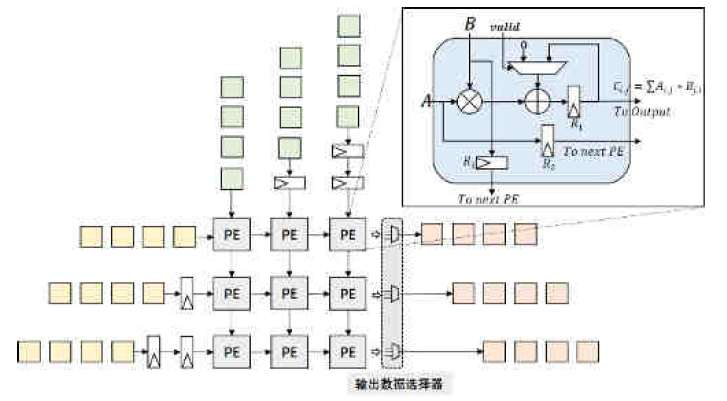

# tpu-systolic-array-4x4

In this mini-project, I am using [[1]](#1) as my reference to design, describe, and simulate a **4x4 Output-Stationary Systolic Array** in SystemVerilog. The figure below shows the structure of the target architecture and the internal datapath of each Processing Element (PE). Note that my design is 4x4.

---

## 🏗️ Architecture Overview

The design follows an **Output-Stationary (OS)** dataflow:
- **Activations ($A$):** Streamed row-wise from the left, passing through skew registers to align propagation, and forwarded horizontally cycle-by-cycle via register $R_2$.
- **Weights ($B$):** Streamed column-wise from the top through vertical skewing registers and held/propagated down the columns.
- **Accumulation ($C_{i,j} = \sum A \cdot B$):** Evaluated locally inside each PE and stored in accumulator register $R_1$.
- **Output Readout:** After accumulation completes, row output multiplexers (or a draining chain) route the accumulated matrix results to the output interface.

---

## 📂 Module Descriptions

### Completed Modules:
- **`mux_21`:** 
  A parameterized 2-to-1 multiplexer used in the feedback accumulation path. Driven by the control/valid signal, it selects between zero (`'0`) to clear/initialize a new dot product and the previous accumulation value stored in register $R_1$.
- **`dff_reg_32b`:** 
  A 32-bit flip-flop register with synchronous reset. It serves as accumulator register **$R_1$** in the figure above inside the PE to store running 32-bit partial sums ($C_{i,j}$).
- **`dff_reg_8b`:** 
  An 8-bit flip-flop register with synchronous reset. Used for:
  - Register **$R_2$** inside the PE for horizontal activation pipelining (`act_out`).
  - Register **$R_3$** / vertical pipelining of weights ($B$) down the columns.
  - External triangular skewing registers on activation ($A$) and weight ($B$) inputs to guarantee wave-front synchronization.

---

## 📚 References

<a id="1">[1]</a> *Design and Implementation of Systolic Array-based Accelerator for Convolutional Neural Networks*, **International Journal of Engineering Research and Management (IJERM)**, ISSN: 2349-2058, Volume 11, Issue 04, April 2024.