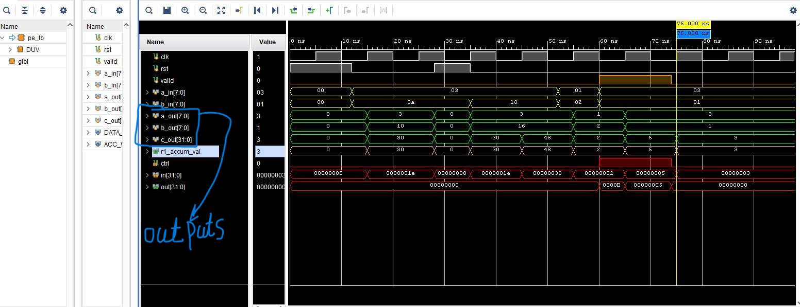
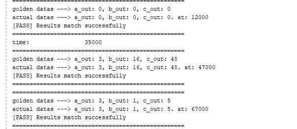

# tpu-systolic-array-4x4

## verification report of Processing Element module

in **pe_tb.sv** file PE module is verified, Targeting various functionalities of the unit including:
- **Reset behaviour**
- **single Mac Operation** 
- **accumulate sequence**
- **data forwarding**
---
**Note:** in **(mod): update readme and start PE verification process** commit these functionalities are explained.

## demonstration of waveforms and scoreboard

